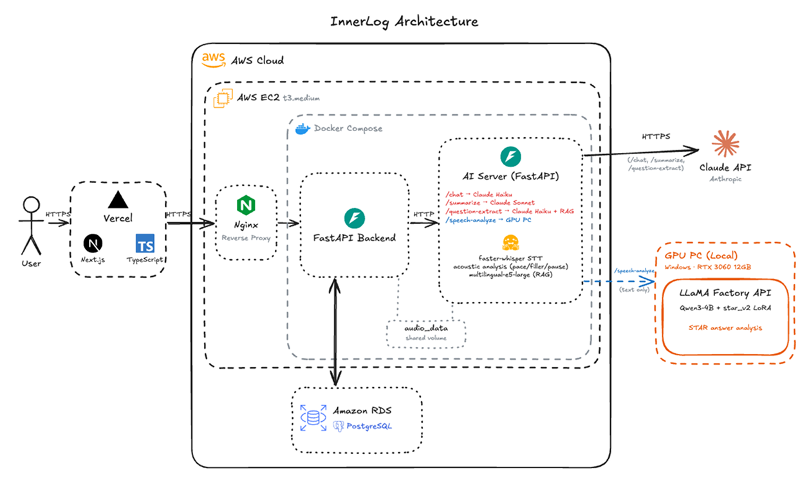

# InnerLog

AI기반 면접 회고 및 스피치 연습 플랫폼

지원한 회사의 전형 진행 상황을 기록하고, 자기소개서를 바탕으로 AI가 뽑아 준 예상 질문에 음성으로 답하며 스피치 피드백을 받고, 면접이 끝난 뒤에는 AI 챗봇과 대화하며 회고를 남길 수 있습니다.

<br/>

## 주요 기능

| 도메인          | 기능                                                                                                                              |
| --------------- | --------------------------------------------------------------------------------------------------------------------------------- |
| **인증**        | 이메일 회원가입·로그인, JWT access/refresh 토큰 발급 및 재발급                                                                    |
| **지원 현황**   | 회사·직무·전형 단계(서류 → 코딩테스트 → 1차/2차/최종 면접) 등록, 단계별 합격/탈락 타임라인 관리                                   |
| **스피치 연습** | 자기소개서 기반 예상 질문 생성(인성/기술/공통), 질문 추가 생성, 답변 음성 업로드 → 말 속도·필러워드·침묵·STAR 구조·논리 흐름 분석 |
| **면접 회고**   | AI 챗봇과 단계별( FACT → INTERPRETATION → STRATEGY ) 회고 대화, 대화 종료 후 강점·보완점·다음 액션 요약                           |
| **대시보드**    | 지원 수, 완료한 회고 수, 반복되는 보완 키워드 Top 3, 전형 단계별 합격 현황, 가장 많이 탈락한 단계                                 |

<br/>

## 기술 스택

| 구분                 | 사용 기술                                            |
| -------------------- | ---------------------------------------------------- |
| Language / Framework | Python 3.11, FastAPI, Pydantic v2                    |
| Database             | PostgreSQL 16 (AWS RDS), SQLAlchemy 2.0, Alembic     |
| Auth                 | JWT (python-jose, HS256), bcrypt                     |
| HTTP Client          | httpx (sync / async)                                 |
| Infra                | Docker, Docker Compose, AWS EC2, AWS RDS, Docker Hub |
| CI/CD                | GitHub Actions                                       |

<br/>

## 아키텍처



- 백엔드와 AI 서버는 같은 EC2에서 Docker Compose로 각각 독립 컨테이너로 실행됩니다.
- 백엔드는 AI 서버 주소(`AI_SERVER_URL`) 하나만 알고, LLM·GPU 호출은 모두 AI 서버가 담당합니다.
- 음성 파일은 두 컨테이너가 함께 마운트한 볼륨에 저장하고, AI 서버에는 **파일 경로만** 전달합니다.

AI 서버와 주고받는 요청·응답 형식은 [docs/ai_api.md](docs/ai_api.md), 인프라 구성과 타임아웃 설계는 [docs/architecture.md](docs/architecture.md)에 정리되어 있습니다.

<br/>

## 프로젝트 구조

```
app/
├── api/            # 라우터: 요청 파싱 → 서비스 호출 → 응답 생성 (얇게 유지)
│   └── docs/       # 라우트별 OpenAPI 메타데이터 (summary, description, 에러 예시)
├── services/       # 비즈니스 로직, DB 쿼리, AI 서버 호출
├── models/         # SQLAlchemy 2.0 ORM 모델
├── schemas/        # Pydantic 요청/응답 모델
└── core/           # 설정, DB 세션, 도메인 예외
alembic/            # DB 마이그레이션
loadtest/           # 부하테스트 하네스와 결과 리포트
docs/               # AI 연동 명세, 인프라 아키텍처 문서
```

<br/>

## 설계 포인트

### 1. 외부 AI 호출 구간의 동시성 개선 (sync → async)

AI 서버 응답은 수십 초가 걸립니다. 처음 구현에서는 이 시간 동안 **워커 스레드와 DB 커넥션을 계속 잡고 있어서**, 동시 요청이 조금만 늘어도 커넥션 풀(15개)이 바닥났습니다.

- 동기 `httpx.Client` 호출을 `httpx.AsyncClient`로 바꿔 대기 시간을 이벤트 루프에서 처리하도록 했습니다.
- 서비스 로직을 **DB 읽기 → 커밋으로 커넥션 반환 → AI 호출(커넥션 없이 대기) → DB 쓰기** 3단계로 나눴습니다.
- DB 읽기·쓰기 단계는 스레드에서 실행합니다. 커넥션을 기다리는 동안 이벤트 루프가 멈추면 서버 전체가 멈추기 때문입니다.

전환 효과는 두 가지 부하테스트로 확인했습니다. 외부 AI는 목(mock) 서버로 대체해 백엔드 동작만 분리해서 측정했습니다.

#### 실험 ① 예상 질문 추가 생성 — 처리량

- **목적:** AI를 기다리는 동안 커넥션과 스레드를 놓으면 처리량이 얼마나 늘어나는지 확인
- **조건:** 목 AI 고정 지연 2초, 커넥션 풀 15, uvicorn 단일 워커, 동시성 5~100을 단계별로 20초씩. 동기·비동기 각 3회 측정해 중앙값으로 비교
- **판단 기준:** 회차 간 편차(최대 약 15%)보다 크고, **비동기의 가장 나쁜 회차가 동기의 가장 좋은 회차보다 나을 때만** 개선으로 판단
- **결과 (3회 중앙값):** 커넥션 풀이 포화되는 동시성 20 이상의 모든 구간에서 기준을 만족했습니다.

| 동시성 | 처리량 (RPS)           | p95 지연                      | 실패율        |
| -----: | ---------------------- | ----------------------------- | ------------- |
|     50 | 4.8 → **21.2** (4.4배) | 12,447ms → **2,877ms** (-77%) | 0% → 0%       |
|    100 | 0 → **38.8**           | — → 3,751ms                   | **100% → 0%** |

- **검증:**
  - 동기의 처리량 상한(약 6.9 RPS)이 이론값(커넥션 15개 ÷ 지연 2초 = 7.5 RPS)에 근접합니다. 병목이 커넥션 풀이라는 해석과 맞습니다.
  - 동기의 500 응답은 백엔드 로그에서 모두 커넥션 풀 타임아웃으로 확인했고, 비동기는 3회 모두 에러가 0건이었습니다.
  - 2026년 8월 첫 측정과 10월 재측정(3회)의 동기 결과가 같은 양상이라 재현성을 확인했습니다.
- **한계:** 로컬 단일 머신에서 측정했습니다. 목 AI의 지연이 고정값이고, 기존 질문과 겹치는 질문만 돌아오는 조건이라 DB 쓰기 경로는 측정하지 않았습니다.

#### 실험 ② 스피치 분석 — 장애 격리

- **목적:** 스피치 분석(AI 응답 실측 약 110초)이 몰릴 때 AI와 무관한 API가 영향을 받는지 확인
- **조건:** 목 AI 지연 60초(커넥션 대기 한도 30초보다 길게), 커넥션 풀 15, 단일 워커. 스피치 분석 N건(0~30)을 걸어 둔 채 목록 조회 API를 동시성 10으로 90초간 호출
- **판단 기준:** 목록 조회의 처리량·p95가 분석이 없을 때(N=0) 대비 **±10%(측정 잡음 범위) 안이고 실패가 0이면** "영향 없음"
- **결과:** 동기는 분석이 커넥션 풀 크기(15건)만큼 몰리자 다른 API까지 멈췄습니다. 비동기는 30건에서도 기준을 만족했습니다.

| 동시 스피치 분석 | 다른 API 처리량 (RPS) | 다른 API p95 지연   | 다른 API 실패율 | 스피치 분석 실패 |
| ---------------: | --------------------- | ------------------- | --------------- | ---------------- |
|               15 | 0.4 → **612**         | 29,828ms → **26ms** | **42% → 0%**    | 0건 → 0건        |
|               30 | 0.1 → **596**         | 29,828ms → **27ms** | **77% → 0%**    | **84건 → 0건**   |

- **검증:**
  - 동기의 500 응답 137건이 백엔드 로그의 커넥션 풀 타임아웃 137건과 정확히 일치하고, 무너지는 지점(15건)이 커넥션 풀 크기와 같습니다.
  - 비동기의 스피치 분석 성공 수가 계산값(워커 수 × 2)과 정확히 일치해, 중간에 멈추거나 실패한 분석이 없었음을 확인했습니다.
  - 전환한 API의 기능 검증 16개(정상, 중복 요청, 다른 사용자 리소스, AI 장애 시 파일 정리 등)를 통과했습니다.
- **중간 발견:** 첫 전환 초안에서는 `async def` 안의 동기 DB 호출이 커넥션을 기다리며 **이벤트 루프를 최대 30초 멈추는** 문제가 있었습니다. p95에는 드러나지 않고 처리량과 타임아웃 건수에서만 보였습니다. DB 단계를 스레드로 옮긴 뒤 같은 조건으로 재측정해 해결을 확인했고, 이미 배포된 질문 추가 생성 코드의 같은 문제도 함께 고쳤습니다.
- **한계:** 조건마다 1회만 측정했고, 로컬 단일 머신에서 측정했습니다. 스피치 분석 속도 자체는 AI 서버가 결정하므로, 이 실험이 보여주는 건 분석 성능이 아니라 장애 격리입니다.

실험 설계, 원인 분석 로그, 전체 수치와 한계는 [loadtest/REPORT.md](loadtest/REPORT.md)에, 직접 재현하는 방법은 [loadtest/README.md](loadtest/README.md)에 있습니다.

### 2. AI 서버 장애를 원인별로 구분

AI 호출 타임아웃은 연결(`connect=5s`)과 응답 대기(`read=90s`, 스피치 분석은 `180s`)를 나눠 설정했습니다. 그래서 AI 서버가 내려가 있으면 90초를 기다리지 않고 5초 안에 실패를 알 수 있습니다. 실패는 원인에 따라 다른 응답으로 내려갑니다.

| 예외                       | HTTP | 상황                                  |
| -------------------------- | ---- | ------------------------------------- |
| `AIServerUnreachableError` | 503  | AI 서버에 연결 자체가 안 됨           |
| `AIServerTimeoutError`     | 504  | 연결은 됐지만 응답이 제한 시간을 넘김 |
| `AIServerError`            | 502  | 그 밖의 오류 응답, 응답 파싱 실패     |

스피치 분석이 실패하면 업로드된 음성 파일도 함께 삭제합니다.

### 3. 예외 클래스 하나로 응답과 API 문서를 함께 관리

모든 도메인 에러는 `InnerLogException`을 상속하고 `{code, message}` 형태의 응답 본문을 가집니다. `main.py`의 핸들러 하나가 이를 JSON으로 내려줍니다.

Swagger의 에러 응답 예시도 `error_response(설명, *예외클래스)`가 **예외 클래스에서 직접 생성**합니다. 에러 문구나 코드를 바꾸면 문서도 자동으로 따라 바뀌어서 코드와 문서가 어긋나지 않습니다.

### 4. 리소스 소유권 검증

지원 현황, 질문, 회고 세션을 조회할 때는 항상 **리소스 ID와 로그인한 사용자 ID를 함께** 조건으로 겁니다. 다른 사용자의 리소스 ID를 알아도 접근할 수 없습니다.

### 5. AI 응답 구조를 DB 제약으로 검증

스피치 분석 결과 중 구조가 자주 바뀌는 항목(`star_score`, `coherence`)은 JSONB로 저장합니다. 대신 `CHECK` 제약으로 필수 키와 값 타입을 강제해, AI 응답 명세가 바뀌어 잘못된 데이터가 들어오면 저장 단계에서 걸러지도록 했습니다.

<br/>

## API

| Method | Endpoint                                                | 설명                                   |
| ------ | ------------------------------------------------------- | -------------------------------------- |
| POST   | `/auth/signup`                                          | 회원가입                               |
| POST   | `/auth/login`                                           | 로그인                                 |
| POST   | `/auth/refresh`                                         | 토큰 재발급                            |
| POST   | `/applications`                                         | 지원 현황 생성                         |
| GET    | `/applications`                                         | 지원 현황 목록 조회                    |
| GET    | `/applications/{application_id}`                        | 지원 현황 상세 조회                    |
| PATCH  | `/applications/{application_id}/stage-result`           | 전형 결과(합격/탈락) 수정              |
| POST   | `/speech-practices`                                     | 스피치 연습 등록 (예상 질문 최초 생성) |
| GET    | `/speech-practices/{application_id}/questions`          | 예상 질문 목록 조회                    |
| POST   | `/speech-practices/{application_id}/questions`          | 예상 질문 추가 생성                    |
| POST   | `/speech-practices/questions/{question_id}/submissions` | 답변 음성 업로드 및 스피치 분석        |
| POST   | `/retrospects`                                          | 면접 회고 시작                         |
| GET    | `/retrospects`                                          | 지원 현황별 회고 세션 목록 조회        |
| GET    | `/retrospects/{session_id}`                             | 회고 세션 상세 조회                    |
| POST   | `/retrospects/{session_id}/chat`                        | 회고 대화 한 턴                        |
| POST   | `/retrospects/{session_id}/summarize`                   | 회고 분석 결과 생성/조회               |
| GET    | `/dashboard`                                            | 대시보드 조회                          |

`/auth/*`를 제외한 모든 API는 `Authorization: Bearer <access_token>` 헤더가 필요합니다. 요청·응답 예시는 Swagger UI(`/docs`)에서 확인할 수 있습니다.

<br/>

## 로컬에서 실행하기

<details>
<summary>실행 방법 펼치기 (의존성 설치, PostgreSQL, 환경변수, 마이그레이션)</summary>

### 1. 의존성 설치

```bash
python3.11 -m venv venv
source venv/bin/activate
pip install -r requirements.txt
```

### 2. PostgreSQL 실행

```bash
docker run -d --name innerlog-db \
  -e POSTGRES_USER=innerlog \
  -e POSTGRES_PASSWORD=<비밀번호> \
  -e POSTGRES_DB=innerlog \
  -p 5432:5432 \
  postgres:16-alpine
```

### 3. 환경변수 설정

프로젝트 루트에 `.env` 파일을 만듭니다.

```env
DATABASE_URL=postgresql://innerlog:<비밀번호>@localhost:5432/innerlog
SECRET_KEY=<임의의 긴 문자열>
AI_SERVER_URL=http://localhost:8001
AUDIO_UPLOAD_DIR=/tmp/innerlog/audio
```

| 변수               | 필수 | 설명                                                                                 |
| ------------------ | :--: | ------------------------------------------------------------------------------------ |
| `DATABASE_URL`     |  ✅  | PostgreSQL 접속 주소 (psycopg2)                                                      |
| `SECRET_KEY`       |  ✅  | JWT 서명 키                                                                          |
| `AI_SERVER_URL`    |      | AI 서버 주소 (기본값 `http://localhost:8000`)                                        |
| `AUDIO_UPLOAD_DIR` |      | 음성 파일 저장 경로 (기본값 `/uploads/audio`). AI 서버와 같은 경로를 바라봐야 합니다 |

> AI 서버도 기본 포트가 8000이라 로컬에서는 백엔드와 겹칩니다. AI 서버를 `--port 8001`로 실행하고 `AI_SERVER_URL`을 그 주소로 맞춰 주세요.

### 4. 마이그레이션 적용 후 서버 실행

```bash
alembic upgrade head
uvicorn app.main:app --reload --port 8000
```

<http://localhost:8000/docs>에서 API 문서를 확인할 수 있습니다.

> 예상 질문 생성, 스피치 분석, 면접 회고는 [AI 서버](https://github.com/innerlog-2026/innerlog-ai)가 함께 실행 중이어야 동작합니다. 인증·지원 현황·대시보드는 AI 서버 없이도 사용할 수 있습니다.

</details>

<br/>

## 배포

```
main 브랜치 push → GitHub Actions → Docker 이미지 빌드 → Docker Hub push → EC2에 SSH 접속 → docker compose pull & up
```

- 워크플로: [.github/workflows/deploy.yml](.github/workflows/deploy.yml)
- 운영용 Compose 파일: [docker-compose.prod.yml](docker-compose.prod.yml)
- 백엔드 컨테이너는 시작할 때 `alembic upgrade head`를 먼저 실행해 스키마를 최신으로 맞춥니다.
- 운영 환경변수(`.env.backend`)는 레포에 포함하지 않고 EC2에서 직접 관리합니다.
