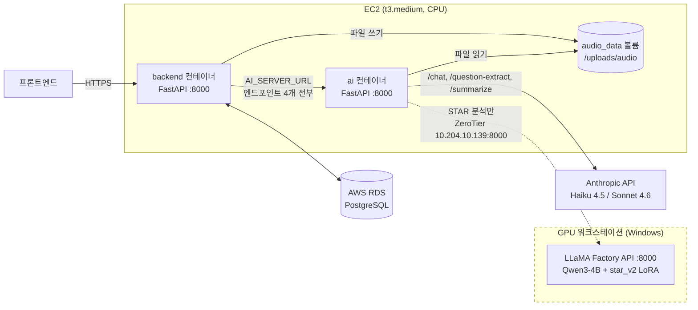
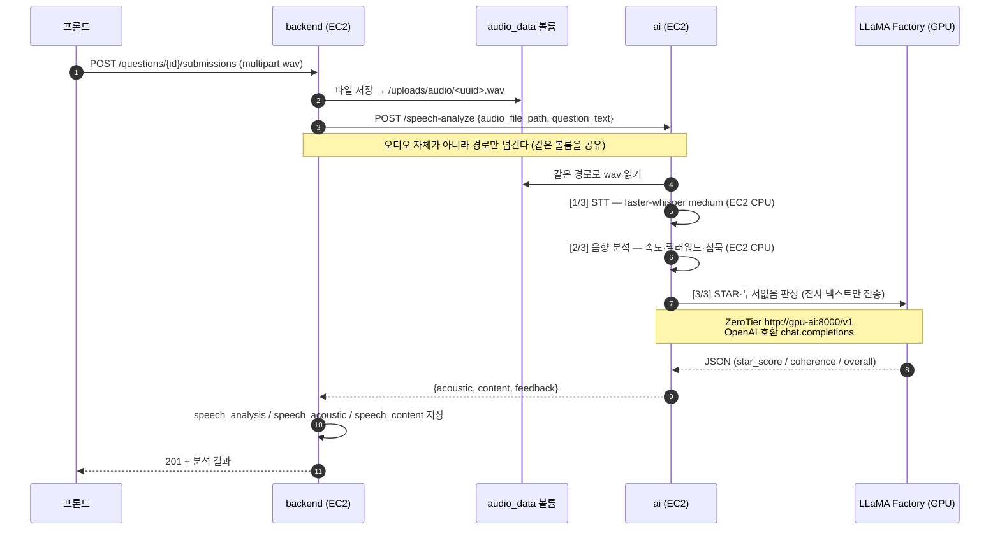

# InnerLog 인프라 아키텍처

> 최종 갱신: 2026-09-13 · 대상 브랜치: `refactor/#31-retrospect-gate` 이후
> 관련 문서: [`docs/ai_api.md`](./ai_api.md) (AI 서버 요청/응답 계약)

## 한 줄 요약

**백엔드는 AI 서버 주소 하나(`AI_SERVER_URL`)만 안다.** 네 개 엔드포인트 모두 EC2 안의 AI 컨테이너로 간다.
GPU 머신을 호출하는 것은 **`/speech-analyze` 안의 STAR 분석 단계 하나뿐**이고, 그 호출은 백엔드가 아니라
**AI 서버가** ZeroTier 오버레이 망을 통해 수행한다.

---

## 1. 호스트 구성

| 호스트 | 정체 | 올라가 있는 것 | 주소 |
| --- | --- | --- | --- |
| **EC2** (t3.medium, CPU) | 상시 가동 프로덕션 | `backend` 컨테이너, `ai` 컨테이너 | 퍼블릭 IP / ZeroTier `10.204.10.94` |
| **AWS RDS** | PostgreSQL | 스키마 전체 | EC2에서만 접근 |
| **GPU 워크스테이션** (Windows, RTX, 12GB VRAM) | AI 개발자 개인 PC | LLaMA Factory API 서버 (`star_v2` LoRA) | ZeroTier `10.204.10.139` |
| **Anthropic API** | 외부 SaaS | Claude Haiku 4.5 / Sonnet 4.6 | `api.anthropic.com` |

GPU 머신은 **개인 PC**다. 상시 가동을 보장하지 않으며, 원격 조작은 Parsec(사람이 쓰는 원격 데스크톱)으로,
서버 간 통신은 ZeroTier로 분리되어 있다. **Parsec은 서빙 경로가 아니다** — Parsec 세션을 끊어도
모델 서버는 계속 떠 있어야 하고, 그래서 Windows 작업 스케줄러(`InnerLog-star_v2`, `S4U` 로그온)로 등록해 두었다.

---

## 2. 전체 호출 흐름



실선 = 상시 경로, 점선 = `/speech-analyze` 요청일 때만 타는 경로.

---

## 3. 엔드포인트별 실제 추론 주체

백엔드가 AI 서버를 호출하는 지점은 네 곳뿐이다.

| 백엔드 호출부 | AI 엔드포인트 | 추론 주체 | GPU 사용 |
| --- | --- | --- | --- |
| `speech.py:_extract_questions` / `_extract_questions_async` | `POST /question-extract` | Claude API | ❌ |
| `speech.py:_analyze_speech_ai` | `POST /speech-analyze` | **STT·음향분석 = EC2 CPU / STAR·두서없음 = GPU** | ✅ (부분) |
| `retrospect.py:_chat_ai` | `POST /chat` | Claude Haiku 4.5 | ❌ |
| `retrospect.py:_summarize_ai` | `POST /summarize` | Claude Sonnet 4.6 | ❌ |

> AI 서버에는 `PATCH /result-update` 도 있으나 **백엔드에서 호출하지 않는다** (현재 미연동).

### `/summarize`를 GPU로 보내지 않기로 한 이유

`summarize_v1` LoRA도 GPU 머신에 준비되어 있지만 **Claude Sonnet으로 확정**했다.

- `star_v2` 로딩 상태에서 VRAM이 **8580MiB / 12288MiB** 점유 — 남은 3.6GB로는 fp16 4B 모델을 하나 더 못 띄운다.
- 어댑터 두 개를 한 서버에서 돌리려면 vLLM 멀티-LoRA가 필요한데 **vLLM은 Windows를 공식 지원하지 않는다.**
- Claude 경로는 이미 구현되어 있어 추가 작업이 0이고, **GPU가 꺼져도 회고 요약은 계속 동작**한다(장애 격리).

따라서 `.env.ai`에 `SUMMARY_MODE=claude`를 넣는다. (AI 레포의 `.env.example` 기본값은 `local`이라 **반드시 덮어써야 한다.**)

---

## 4. `/speech-analyze` 상세 — 무엇이 EC2에 남고 무엇이 GPU로 가나



핵심 두 가지:

1. **오디오 파일은 ZeroTier를 건너지 않는다.** wav는 EC2의 공유 볼륨에 남고, GPU로 가는 것은 STT 결과인
   **전사 텍스트뿐**이다. 업로드 상한이 100MB인데 이걸 원격으로 보내지 않아도 되는 구조다.
2. **STT가 EC2 CPU에서 돌고, 이게 전체 지연의 대부분이다.** 아래 실측 참조.

### STT 실측 (2026-09-13, t3.medium)

조건: faster-whisper `medium` / `int8` / `beam_size` 기본값(5) / 모델 캐싱 없음 / 동시 요청 없음.
AI Hub ICT 면접 답변 샘플 3개를 2바퀴 (`innerlog-ai` 의 `data/sample/`). 2회 측정했고 아래는 2차(전 회차 완주).

| 회차 | 오디오 | STT | 실시간 대비 | 음향 | STT+음향+STAR(15초) |
| --- | --- | --- | --- | --- | --- |
| 1 | 69.9초 | 80.2초 | 1.15x | 4.5초 | 100초 |
| 2 | 86.2초 | 129.3초 | 1.50x | 1.1초 | **145초** |
| 3 | 90.9초 | 121.3초 | 1.33x | 0.6초 | 137초 |
| 4 | 69.9초 | 80.3초 | 1.15x | 0.3초 | 96초 |
| 5 | 86.2초 | 130.3초 | 1.51x | 0.8초 | **146초** |
| 6 | 90.9초 | 118.4초 | 1.30x | 0.3초 | 134초 |

**판정: 180초 예산은 안전하지 않다.**

- STT가 실시간의 **1.15~1.51배**. 전체 지연의 80% 이상을 차지한다 — STAR 15초, 음향 1초 미만은 부차적이다.
- 최악 146초로 통과했지만 **여유 34초는 단일 요청 + 70~91초 샘플 기준**이다.
  vCPU가 2개뿐이라 동시 2건이면 STT가 거의 배증해 즉시 초과한다.
- **2분짜리 답변에 1.5x면 STT 단독 180초** — 예산을 넘긴다. 실제 면접 답변은 2~3분이 흔하다.

### 측정에서 확인된 성질 세 가지

**① 재현성이 높다.** 같은 파일 1회차 vs 4~6회차 차이가 0.1초 / 1.0초 / 2.9초. 측정값을 믿고 판단해도 된다.

**② 회차가 늘어도 열화되지 않는다.** 1차 측정에서 111383이 84.4초 → 91.4초로 느려져 CPU 크레딧 스로틀링을
의심했으나, 2차에서는 80.2초 → 80.3초로 재현되지 않았다. `vmstat` steal 0 · idle 100,
`OOMKilled=false` · `RestartCount=0`, `dmesg` 에 OOM 기록 없음 — **스로틀링도 OOM 도 아니다.**
같은 증상이 재발해도 이 둘을 다시 의심하지 말 것. 호출 후 메모리도 602Mi 로 정상 회수된다(누수 없음).

**③ 소요 시간이 오디오 길이에 비례하지 않는다.** 86.2초(1.50x)가 90.9초(1.30x)보다 오래 걸린다.
whisper 의 디코딩 비용은 재생 시간이 아니라 **생성할 토큰 수**에 비례하기 때문이다 — 말을 빠르고 많이 한
답변일수록 느리다. 따라서 **녹음 길이 상한만으로는 응답 시간을 보장할 수 없다.**

> 메모리: 가용 3.0GiB 에 요청당 1.5~2GB 를 쓰므로 **동시 2건이 실질 한계**, 3건이면 OOM.


### beam_size / 모델 캐싱 효과 실측 (2026-09-13)

가장 느렸던 샘플(`ckmk_a_ict_m_e_42650`, 86.2초)로 측정. 모델을 **한 번만** 올려놓고 beam 5 / 1 을 연달아 실행.

| | STT | 실시간 대비 | 전사 글자수 |
| --- | --- | --- | --- |
| `beam_size=5` (faster-whisper 기본값, 현재 코드) | 118.6초 | 1.38x | 458자 |
| `beam_size=1` (greedy) | **93.0초** | 1.08x | 459자 |

- **속도 1.28배 단축** (25.6초, 21.6%).
- **정확도 손실 무시 가능.** 458자 vs 459자, 차이는 `인도차이나` → `인도 차이나` 띄어쓰기 하나뿐.
- 같은 파일의 앞선 측정(129.3 / 130.3초)과 beam 5(118.6초)의 차이 **약 11초**가
  매 요청 `WhisperModel` 을 새로 만드는 비용 = `lru_cache` 로 없앨 수 있는 몫.

| 적용 | 이 파일 STT | 합계(+음향+STAR 15초) |
| --- | --- | --- |
| 현재 | 130.3초 | **146초** |
| `lru_cache` 만 | ~118.6초 | 134초 |
| `lru_cache` + `beam_size=1` | **93.0초** | **109초** |

**최악 146초 → 109초.** 180초 예산 대비 여유가 19% → 39%.

### 적용 후 실측 (2026-09-13, EC2 컨테이너)

`lru_cache` + `beam_size=1` 을 적용해 EC2에 배포한 뒤 같은 파일(`ckmk_a_ict_m_e_42650`, 86.2초)로 3회 연속 측정.

| | STT | 실시간 대비 |
| --- | --- | --- |
| 적용 전 (beam 5 + 매 요청 모델 로딩) | 130.3초 | 1.51x |
| 적용 후 1회차 (모델 로딩 포함) | 105.0초 | 1.22x |
| **적용 후 2회차 (warm)** | **86.8초** | **1.01x** |
| **적용 후 3회차 (warm)** | **86.2초** | **1.00x** |

- **`lru_cache` 효과 ≈ 18.5초** (105.0 − 86.5). 사전 추정 11초보다 컸다.
- **전체 130.3초 → 86.5초, 33.6% 단축.**
- 2·3회차가 86.8 → 86.2초로 거의 동일 — 캐시가 안정적으로 적중한다.

| 시나리오 | 적용 전 | 적용 후 |
| --- | --- | --- |
| 90초 답변 | 146초 (19% 여유) | **약 103초 (43% 여유)** |
| 2분 답변 | 181초 ❌ | **약 136초 (24% 여유)** ✅ |

`STT_MAX_DURATION_SEC=120` 은 이 실측에 잘 맞는다. 다른 샘플에서도 1.0x 근처가 나오면 130~140초까지
올릴 여지가 있으나, 배율이 답변의 발화 밀도에 따라 흔들리므로 측정 없이 올리지 말 것.

> 위 수치는 `docker exec` 로 띄운 **별도 프로세스** 측정이다. 실제 요청은 uvicorn 프로세스를 통과하므로
> `/speech-analyze` 를 직접 호출한 end-to-end 값으로 다시 확인해야 한다.

> **메모리 변화:** 캐싱 이후 whisper 모델(~1.5~2GB)이 uvicorn 프로세스에 **상주**한다.
> 이전에는 요청마다 올렸다 내려 유휴 시 602Mi 로 돌아왔지만, 이제는 첫 스피치 요청 이후 계속 점유한다.
> 총 3.7GiB 중 여유가 줄어드는 대신 동시 요청이 모델을 **공유**하므로 피크는 오히려 낮아진다.
> 동시 요청 시 CTranslate2 가 한 인스턴스를 어떻게 다루는지는 시연 전에 확인할 것.

### end-to-end 실측 (2026-09-13) — GPU STAR 포함

`POST /speech-analyze` 를 EC2 호스트에서 직접 호출(uvicorn 경유, GPU STAR 포함). 같은 86.2초 샘플.

| | 총 시간 | 구성 |
| --- | --- | --- |
| 1회차 | 135.2초 | 모델 로딩 약 25초 포함 |
| **2회차 (warm)** | **110.4초** | STT 86.5 + 음향 ~1 + **GPU STAR ~23초** |

**180초 예산 대비 39% 여유.** GPU STAR 를 새로 포함하고도 개선 전(146초, STAR 제외)보다 낫다.

STAR 가 단독 측정치 15.0초보다 긴 23초인 것은 생성 텍스트가 훨씬 많기 때문이다
(항목별 comment 4개 + coherence detail + overall). 비정상이 아니다.

**응답 포맷은 PDF 최종 명세와 일치함을 확인했다** — `content.question_type` 존재,
`content.coherence` 객체, `content.overall` 없음, 최상위 `feedback` 3필드, `star_detail` 없음.
백엔드 스키마(`app/schemas/speech.py`)와 마이그레이션 `d4f1b6c2a705` 가 이 응답을 그대로 받는다.

> **미해결 관찰:** 위 측정에서 `question_type` 이 **행동형**인데 `star_score` 4개 항목이 모두
> `present: null` 로 왔다(코멘트는 정상 생성). 명세상 `null` 은 비행동형일 때만 나와야 한다.
> 다만 테스트에 쓴 오디오(베트남 근무 희망)와 질문("팀 프로젝트 갈등 해결 경험")이 서로 맞지 않아
> 모델이 "판단 불가"로 처리했을 가능성이 크다. **질문에 맞는 STAR 답변으로 재확인 필요.**
> 프론트가 `present` 로 ✅/❌ 를 그리므로 `null` 이 남으면 표시할 값이 없다.

### 두 조치를 적용해도 남는 것

| 시나리오 | 현재 | 개선 후 |
| --- | --- | --- |
| 90초 답변 | 146초 ✅ | 109초 ✅ |
| 2분 답변 | 181초 ❌ | 145초 ✅ |
| 3분 답변 | 267초 ❌ | 209초 ❌ |
| **동시 2건** | ❌ | **❌** |

**동시성은 `beam_size` 로 풀리지 않는다.** vCPU 2개를 나눠 쓰므로 93초가 ~186초가 되어 예산을 넘는다.
세마포어로 직렬화해도 대기 시간이 그대로 180초 예산에 포함되므로 해결되지 않는다.
동시 요청을 감당하려면 **vCPU 증설**(`c7i.xlarge` 4 vCPU/8GB 등)이거나, 근본적으로는 **비동기 작업 큐 + 폴링**이다.

### 개선 후보 (비용 낮은 순)

| 조치 | 예상 효과 | GPU 머신 작업 | 정확도 영향 |
| --- | --- | --- | --- |
| `beam_size=1` (현재 기본값 5) | **1.28배 단축 (실측)** | 없음 | **거의 없음 (실측: 띄어쓰기 1곳)** |
| `WhisperModel` 을 `lru_cache` 로 캐싱 | **요청당 ~11초 제거 (실측)** + 메모리 안정 | 없음 | 없음 |
| 인스턴스 변경 (**vCPU 4개 + RAM 8GB**, 예: `c7i.xlarge`) | **동시 요청 대응** — 위 두 조치로는 못 고치는 유일한 항목 | 없음 | 없음 |
| `medium` → `small` | 2~3배 단축 | 없음 | 한국어 인식률 하락 → STAR 입력 품질 영향 |
| STT를 GPU로 이전 | 6~8배 단축 | **큼** (별도 STT 서비스 신규 작성 + Windows CUDA 설치 + 포트/스케줄러 추가) | 없음 |

> `vad_filter=True` 는 쓰지 말 것. `_count_silences()` 가 세그먼트 간 1.5초 이상 간격을 세는 방식이라
> VAD 로 침묵을 건너뛰면 침묵 통계가 망가진다.

> **주의:** 인스턴스 변경 시 vCPU 만 보면 안 된다. `c7i.large` 는 2 vCPU / **4GB** 라 메모리가 그대로다.
> 동시 요청 2건 이상을 감당하려면 **RAM 8GB** 급(`t3.large`, `m7i.large`)이 필요하다.

---

## 5. 네트워크 경로

```
EC2 (10.204.10.94) ──ZeroTier 오버레이(UDP 9993)── GPU (10.204.10.139)
                                                    Windows 방화벽:
                                                    TCP 8000 인바운드 허용
                                                    RemoteAddress = 10.204.10.0/24
```

- ZeroTier 네트워크는 **Private + 수동 멤버 승인**을 유지한다. 미승인 노드는 `listnetworks`에서 `ACCESS_DENIED`로 뜬다.
- 모델 서버는 `0.0.0.0:8000`에 바인딩한다. ZeroTier IP에 직접 바인딩하면 AI 개발자의 `localhost` 로컬 테스트가 깨진다.
  **외부 노출 차단은 바인딩이 아니라 방화벽의 `-RemoteAddress` 스코프로 한다** — 8000 포트를 LAN 전체에 열지 않는다.
- EC2의 `ai` 컨테이너는 `extra_hosts`로 `gpu-ai` 이름을 ZeroTier IP에 매핑해 쓴다.
  (IP가 바뀌어도 compose 한 줄만 고치면 되고, 애플리케이션 설정에 IP 리터럴이 박히지 않는다.)

```yaml
# docker-compose.prod.yml — ai 서비스
    extra_hosts:
      - "gpu-ai:10.204.10.139"
```

- **호스트명은 `gpu-ai` (하이픈).** 언더스코어(`gpu_ai`)는 RFC 1123 위반이라 리졸버가 거부할 수 있고,
  실제로 EC2 compose 에 `gpu_ai` 로 적혀 있어 이름 해석이 실패한 적이 있다(7절 참고).
  `extra_hosts` 는 컨테이너 **생성 시점**에 `/etc/hosts` 에 박히므로 `docker restart` 로는 반영되지 않는다 —
  `docker compose -f docker-compose.prod.yml up -d --force-recreate ai` 로 재생성하고
  `docker exec innerlog-ai cat /etc/hosts | grep gpu-ai` 로 확인할 것.
  (배포 워크플로 `deploy.yml` 은 `backend` 만 재기동하므로 `ai` 는 수동 재생성이 필요하다.)
- ZeroTier Central에서 두 멤버 모두 **Managed IP를 고정해 두었다** (2026-09-13). 고정하지 않으면 재접속 시
  주소가 바뀌어 `extra_hosts` 매핑이 조용히 깨진다 — 멤버를 추가하거나 재생성할 때도 반드시 고정할 것.

---

## 6. 환경변수 — 어느 값이 어디를 가리키나

### `.env.backend` (EC2, backend 컨테이너)

| 키 | 값 | 설명 |
| --- | --- | --- |
| `DATABASE_URL` | RDS DSN | psycopg2 |
| `SECRET_KEY` | — | JWT HS256 서명 |
| `AI_SERVER_URL` | `http://ai:8000` | **백엔드가 아는 유일한 AI 주소.** GPU 주소는 모른다 |
| `AUDIO_UPLOAD_DIR` | `/uploads/audio` | `ai` 컨테이너와 **같은 경로**로 마운트되어야 함 |

### `.env.ai` (EC2, ai 컨테이너)

| 키 | 값 | 설명 |
| --- | --- | --- |
| `ANTHROPIC_API_KEY` | — | `/chat`, `/question-extract`, `/summarize`용. **GPU 머신으로 복사 금지** (개인 PC) |
| `SPEECH_ANALYSIS_MODE` | `local` | `local` = GPU의 star_v2 사용, `claude` = GPU 없이 폴백 |
| `STAR_LOCAL_API_URL` | `http://gpu-ai:8000/v1` | **GPU를 가리키는 유일한 설정값** |
| `SUMMARY_MODE` | `claude` | 위 4절 참조. `.env.example` 기본값 `local`을 덮어써야 함 |
| `RUNNING_IN_CONTAINER` | `1` | 기동 검증 가드 활성화 (아래) |

> **기동 검증 가드:** `api/main.py`의 `validate_environment()`는 `RUNNING_IN_CONTAINER`가 설정된 상태에서
> `*_LOCAL_API_URL`의 호스트가 `localhost`/`127.0.0.1`/`::1`/`0.0.0.0`이면 기동을 실패시킨다.
> 컨테이너 안의 localhost는 AI 서버 자기 자신이라, 주입을 빠뜨리면 **자기 자신을 호출해 엉뚱한 404**가 나고
> 첫 요청에서야 드러나기 때문이다. 이 가드 덕분에 `docker compose up -d ai` 직후 로그에서 바로 잡힌다.

---

## 7. 타임아웃 체인

외부 호출은 **바깥쪽이 안쪽보다 길어야** 한다. 역전되면 안쪽이 아직 일하는 중에 바깥쪽이 먼저 포기해서
원인 파악이 어려운 실패가 난다.

| 구간 | 현재 값 | 비고 |
| --- | --- | --- |
| 백엔드 → AI `/question-extract`, `/chat`, `/summarize` | `connect=5s, read=90s` | |
| 백엔드 → AI `/speech-analyze` | `connect=5s, read=180s` | STT + 음향 + STAR가 직렬로 이어짐 |
| AI → GPU (OpenAI 클라이언트) | **미설정 (기본 600초)** | ⚠️ 체인 역전 — AI 레포 수정 필요 |

`connect`를 `read`에서 분리한 이유: 단일 숫자로 주면 connect에도 같은 90초가 적용되어,
**ZeroTier가 끊겼을 때 TCP 연결 시도만으로 90초를 기다린 뒤에야** 에러가 나간다.
5초로 떼어놓으면 경로 단절을 즉시 감지한다.

실패는 원인별로 구분해 올라간다 (`app/core/exceptions.py`):

| 예외 | HTTP | code | 언제 |
| --- | --- | --- | --- |
| `AIServerUnreachableError` | 503 | `AI_SERVER_503` | 연결 자체 실패 (AI 서버 다운, ZeroTier 단절) |
| `AIServerTimeoutError` | 504 | `AI_SERVER_504` | 연결은 됐으나 응답 지연 |
| `AIServerError` | 502 | `AI_SERVER_ERROR` | 그 외 (4xx/5xx 응답, 파싱 실패 등) |

세 클래스가 상속 관계라 기존 `except AIServerError:` (분석 실패 시 wav 정리)는 셋 다 잡는다.

### 실패가 실패로 보이게 — `_fallback_content` 제거 (2026-09-13)

**위 예외 체계는 AI 서버가 실패를 실패로 알려줄 때만 작동한다.** 실제로는 그렇지 않았다.

`features/speech_analysis.py` 의 `_call_content_llm()` 이 이렇게 되어 있었다.

```python
    except Exception as e:
        return _fallback_content(str(e))   # "분석 실패" 자리표시자 + HTTP 200
```

내용 분석 LLM 호출이 **어떤 이유로 실패하든** 예외를 삼키고 아래 형태로 200 을 내려보냈다.

```json
"star_score": {
  "situation": {"present": null, "comment": "분석 실패"},
  ... (4개 항목 동일)
}
```

이 때문에 실제로 일어난 일:

| | |
| --- | --- |
| 발단 | EC2 compose 의 `extra_hosts` 를 `gpu-ai` 가 아닌 **`gpu_ai`** 로 적음 (글자 1개) |
| 증상 | `/speech-analyze` 가 **HTTP 200** 을 반환. 정상으로 보임 |
| 실제 | 이름 해석 실패 → GPU 미호출 → 네 항목 모두 `"분석 실패"` |
| 발각 경위 | 응답 시간이 85.6초로 **STT 단독 시간(86.2초)과 거의 같았다.** GPU STAR 15초가 통째로 빠진 것. 시간을 안 봤으면 "GPU 연동 완료"로 넘어갔을 상황 |
| 파급 | 백엔드가 `"분석 실패"` 문자열을 **정상 분석 결과로 DB 에 저장**. `star_score` CHECK 제약도 통과(`present: null` 허용). 제출물이 이미 생성되므로 **사용자는 재시도조차 불가능** |

**조치:** `_fallback_content()` 를 제거하고 `ContentAnalysisError` 로 올려보내도록 변경.

```python
    except Exception as e:
        logger.error("내용 분석 실패 (mode=%s, url=%s): %r",
                     SPEECH_ANALYSIS_MODE, STAR_LOCAL_API_URL, e)
        raise ContentAnalysisError(f"내용 분석에 실패했습니다: {e}") from e
```

원인 예외가 `OpenAIError` / `JSONDecodeError` / `KeyError` 등 제각각이라 단순 `raise` 대신
전용 클래스로 감쌌다(`from e` 로 원인 체인 보존). 호출자는 한 줄로 분기할 수 있다.

`api/main.py` 를 고치지 않아도 `except Exception → HTTPException(500)` 을 타고
백엔드의 `HTTPStatusError → AIServerError → 502` 로 이어져 **동작 자체는 맞다.**
다만 상류 LLM 실패에 500 은 의미상 어긋나므로 아래 매핑을 권장한다.

```python
# api/main.py — /speech-analyze
except AudioTooLongError as e:
    raise HTTPException(status_code=413, detail=str(e))   # 답변이 너무 김
except ContentAnalysisError as e:
    raise HTTPException(status_code=502, detail=str(e))   # 상류 LLM 실패
except Exception as e:
    raise HTTPException(status_code=500, detail=str(e))
```

> **교훈:** 부분 성공을 200 으로 내려보내면 호출자는 실패를 알 수 없다.
> STT·음향이 성공했어도 내용 분석이 실패하면 요청 전체를 실패로 처리하는 편이,
> 반쯤 빈 분석 결과를 영구 저장하는 것보다 낫다.
> 그리고 **응답 코드가 아니라 소요 시간이 이상을 처음 드러냈다** — 성능 측정값을 알고 있으면
> 기능 버그도 같이 잡힌다.

---

## 8. GPU가 꺼지면 무슨 일이 생기나

| 기능 | GPU 다운 시 |
| --- | --- |
| 로그인 / 지원현황 CRUD | ✅ 정상 |
| 예상 질문 생성 (`/question-extract`) | ✅ 정상 (Claude) |
| 회고 챗봇 (`/chat`) | ✅ 정상 (Claude) |
| 회고 요약 (`/summarize`) | ✅ 정상 (Claude Sonnet) |
| **스피치 분석 (`/speech-analyze`)** | ❌ **503** — 5초 안에 판정, 업로드된 wav는 정리됨 |

즉 **장애 범위가 스피치 분석 하나로 격리**되어 있다. `/summarize`를 Claude로 둔 것이 이 격리에 직접 기여한다.
GPU 없이 데모해야 하는 상황이면 `.env.ai`에 `SPEECH_ANALYSIS_MODE=claude`를 넣고 `ai` 컨테이너만 재기동하면
스피치 분석도 Claude로 폴백한다.

---

## 9. 배포

```
개발 → GitHub → GitHub Actions → Docker Hub → EC2에서 pull & up
```

- 백엔드 이미지는 Actions가 빌드/푸시. `APP_DIR=/home/ubuntu/innerlog`.
- AI 이미지는 수동: Apple Silicon에서 빌드할 때 플랫폼을 맞춰야 한다.
  ```bash
  docker buildx build --platform linux/amd64 -t <user>/innerlog-ai:latest --push .
  ```
- `.env.backend` / `.env.ai`는 레포에 없다. **EC2에 직접 접속해 수정**하고 `docker compose up -d <service>`로 재적용한다.
- 백엔드 컨테이너는 기동 시 `alembic upgrade head`를 먼저 돌린다 (`docker-compose.prod.yml`의 `command`).
- 볼륨 두 개를 **모두 유지**해야 한다.
  - `audio_data` — backend ↔ ai 음성 파일 공유
  - `hf_models` — `HF_HOME=/models`. faster-whisper medium(~1.5GB), e5-large(~2.2GB) 캐시.
    **GPU로 옮겨간 것은 STAR 모델뿐이고 이 두 모델은 EC2에 그대로 남는다** — 지우면 첫 요청마다 재다운로드한다.

---

## 10. 현재 열려 있는 항목

| 항목 | 상태 |
| --- | --- |
| EC2 STT 소요시간 | ✅ 측정·개선 완료 (4절). 180초 예산 대비 여유 19% → **43%** |
| `/speech-analyze` end-to-end 실측 | ✅ **110.4초 (warm), 180초 대비 39% 여유** (4절) |
| 행동형인데 `present: null` 로 오는 건 | ❌ 질문에 맞는 STAR 답변으로 재확인 필요. 모델 이슈면 AI 레포 몫 |
| `api/main.py` 예외 매핑 | ❌ `AudioTooLongError`→413, `ContentAnalysisError`→502. 현재는 둘 다 500 (동작은 맞으나 의미가 어긋남) |
| `beam_size=1` + `WhisperModel` 캐싱 | ✅ **적용·배포 완료.** 실측 130.3초 → 86.5초 (33.6% 단축), 합계 146초 → 약 103초 |
| 인스턴스 vCPU·RAM 증설 (2/4GB → 4/8GB) | ❌ **동시 2건이 안 되는 것은 코드로 해결 불가.** 발표 시연 방식에 따라 판단 |
| AI → GPU OpenAI 클라이언트 타임아웃 | ❌ 기본 600초. AI 레포에서 설정 필요 (체인 역전) |
| AI 서버 동시성 제한 | ❌ 없음. GPU는 단일 어댑터 서빙이라 `threading.Semaphore(2)` 권장 |
| `analyze_speech` / `summarize_retrospect` 비동기화 | ❌ 아직 동기 — DB 커넥션(풀 15)을 AI 응답 내내 점유. `loadtest/REPORT.md`의 3단계 패턴(DB 읽기 → commit → AI await → DB 쓰기)을 전파해야 함 |
| GPU PC 재부팅 테스트 | ⏳ AI 개발자와 협의 필요 |
| 오디오 파일 보관 정책 | ❌ 분석 성공 시 wav가 볼륨에 계속 쌓임 (상한 100MB/건) |

### 완료된 항목

| 항목 | 완료 |
| --- | --- |
| ZeroTier 네트워크 승인 (EC2 `10.204.10.94` / GPU `10.204.10.139`) | 2026-09-13 |
| ZeroTier Central 에서 두 멤버 Managed IP 고정 | 2026-09-13 |
| Windows 방화벽 TCP 8000 인바운드 (`10.204.10.0/24` 한정) | 2026-09-13 |
| star_v2 를 `0.0.0.0:8000` 에 서빙 + 작업 스케줄러 등록 (`InnerLog-star_v2`) | 2026-09-13 |
| EC2 → GPU 호출 200 확인 (호스트/컨테이너 양쪽) · STAR 분석 15.0초 실측 | 2026-09-13 |
| `docker-compose.prod.yml` 의 `extra_hosts: gpu-ai` 반영 | 2026-09-13 |
| 백엔드 connect/read 타임아웃 분리 + 503/504/502 에러 구분 | 2026-09-13 |
| STT `lru_cache` + `beam_size=1` 적용 (130.3초 → 86.5초) | 2026-09-13 |
| `_fallback_content` 제거 — LLM 실패를 200 대신 예외로 (7절) | 2026-09-13 |
| `STT_MAX_DURATION_SEC=120` 길이 상한 도입 | 2026-09-13 |
| `extra_hosts` 호스트명 `gpu_ai` → `gpu-ai` 수정, GPU STAR 연동 확인 | 2026-09-13 |
| AI 응답이 PDF 최종 포맷과 일치함을 end-to-end 로 확인 | 2026-09-13 |

---

## 부록 — 운영 시 주의

- GPU PC와 Parsec 계정은 **AI 개발자 소유**다. 로그아웃·자격증명 변경을 하지 않고, 접속 전 알리고,
  모델 서버 재시작이나 재부팅은 사전 협의한다.
- Parsec의 **Disconnect는 로그아웃이 아니다.** 세션을 끊어도 작업 스케줄러로 등록한 모델 서버는 계속 뜬다.
- `nvidia-smi`의 VRAM만 보고 "아무것도 안 돌고 있다"고 판단하지 않는다. Ollama 등은 유휴 시 모델을 언로드해
  프로세스가 살아 있어도 VRAM이 비어 보인다. **프로세스와 포트를 함께 확인**한다.
- GPU 머신에 남긴 변경의 원복 명령:
  ```powershell
  Remove-NetFirewallRule -DisplayName "InnerLog*"
  Unregister-ScheduledTask -TaskName "InnerLog-star_v2" -Confirm:$false
  # 전원 설정 백업: $env:USERPROFILE\Desktop\powercfg_backup_before_innerlog.txt
  ```
